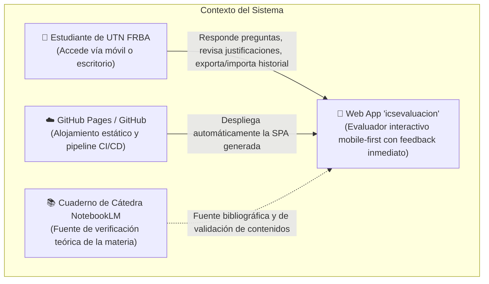
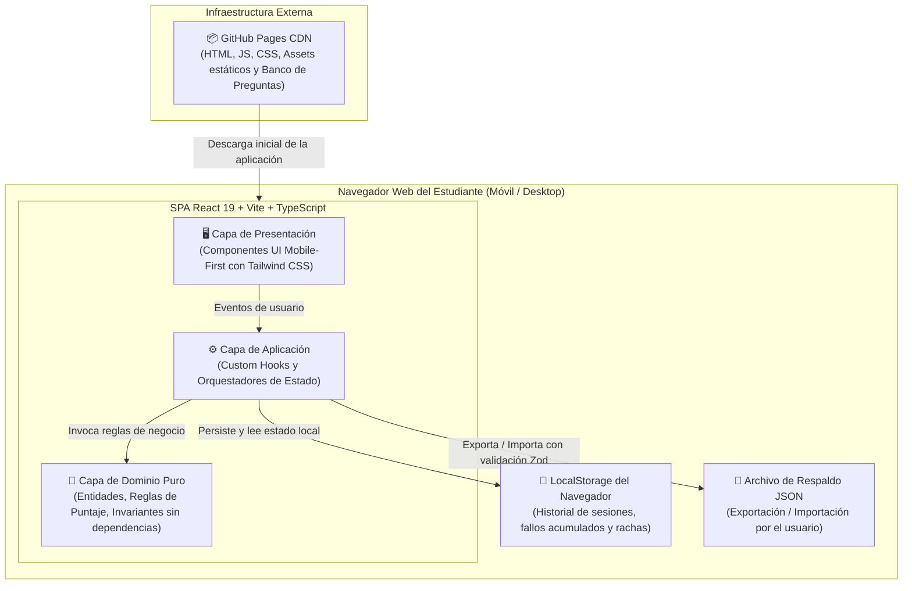

# Diseño de Arquitectura de Software (Modelo C4)
## Proyecto: Evaluador de Ingeniería y Calidad de Software (UTN FRBA)
### Repositorio: `icsevaluacion`

---

## 1. Nivel 1 - Diagrama de Contexto del Sistema

El diagrama de contexto delimita las fronteras del sistema, los usuarios directos y los sistemas externos que interactúan con él.



---

## 2. Nivel 2 - Diagrama de Contenedores

La solución se concibe como una **Single Page Application (SPA)** de arquitectura desacoplada, ejecutada íntegramente en el navegador del cliente para máxima velocidad, privacidad y portabilidad.



---

## 3. Nivel 3 - Diagrama de Componentes

Siguiendo la **Arquitectura Limpia / Puertos y Adaptadores**, el núcleo de dominio no tiene ninguna dependencia de frameworks, React o el DOM.

```mermaid
flowchart LR
    subgraph Presentacion ["Capa de Presentación (UI / React)"]
        VistaConfiguracion["VistaConfiguracion"]
        VistaEvaluacion["VistaEvaluacion"]
        VistaResultados["VistaResultados"]
        VistaHistorial["VistaHistorial"]
        TarjetaPregunta["TarjetaPregunta"]
        BarraProgreso["BarraProgreso"]
        AlertaFeedback["AlertaFeedback"]
    end

    subgraph Aplicacion ["Capa de Aplicación (Hooks / Servicios)"]
        useSesionEvaluacion["useSesionEvaluacion"]
        useProgresoEstudiante["useProgresoEstudiante"]
        useFiltroPreguntas["useFiltroPreguntas"]
        servicioBancoPreguntas["servicioBancoPreguntas"]
    end

    subgraph Dominio ["Capa de Dominio Puro (Sin dependencias externas)"]
        calculadorPuntaje["calculadorPuntaje\n(Fórmula de proporcionalidad y penalización)"]
        evaluadorRespuesta["evaluadorRespuesta\n(Comparador de respuestas y estados)"]
        generadorTanda["generadorTanda\n(Algoritmo Fisher-Yates de barajado y filtrado)"]
        esquemaPregunta["esquemaPregunta & Zod\n(Contratos tipados en frontera)"]
        tiposDominio["tiposDominio\n(Pregunta, Sesion, Opcion, Resultado)"]
    end

    subgraph Infraestructura ["Capa de Infraestructura y Persistencia"]
        repositorioProgresoLocal["repositorioProgresoLocal\n(Adaptador de LocalStorage)"]
        gestorExportacionJson["gestorExportacionJson\n(Serializador y validador de importación)"]
        bancoPreguntasJSON["bancoPreguntas.json\n(Dataset de preguntas)"]
    end

    Presentacion --> Aplicacion
    Aplicacion --> Dominio
    Aplicacion --> Infraestructura
    Infraestructura --> Dominio
    servicioBancoPreguntas --> bancoPreguntasJSON
```



---

## 4. Nivel 4 - Diseño de Código y Fronteras

### 4.1 Estructura Proyectada de Carpetas
```text
src/
├── dominio/                       # 100% TypeScript puro, 0 imports de React/DOM
│   ├── modelos/
│   │   ├── tiposPregunta.ts       # Interfaces de Pregunta, Opcion, Cuatrimestre, Unidad
│   │   ├── tiposSesion.ts         # Interfaces de Sesion, Configuracion, EstadoSesion
│   │   └── tiposProgreso.ts       # Historial, Estadisticas y ResumenSesion
│   ├── servicios/
│   │   ├── calculadorPuntaje.ts   # Cálculo proporcional con penalización acotado a 0
│   │   ├── evaluadorRespuesta.ts  # Calificación determinista de respuestas
│   │   └── generadorTanda.ts      # Barajado Fisher-Yates y filtro multicriterio
│   └── esquemas/
│       ├── esquemaPregunta.ts     # Esquemas Zod de validación de preguntas
│       └── esquemaProgreso.ts     # Esquemas Zod para importación segura de JSON
│
├── aplicacion/                    # Orquestadores y lógica reactiva
│   ├── hooks/
│   │   ├── useSesionEvaluacion.ts # Máquina de estados de la evaluación activa
│   │   ├── useProgresoLocal.ts    # Enlace reactivo con almacenamiento local
│   │   └── useFiltrosSesion.ts    # Selección de cuatrimestre, unidad y cantidad
│   └── contexto/
│       └── ContextoEvaluacion.tsx # Proveedor global de estado liviano
│
├── infraestructura/               # Adaptadores a almacenamiento y datos externos
│   ├── persistencia/
│   │   ├── almacenamientoLocal.ts # Lectura y escritura protegida en LocalStorage
│   │   └── serializadorJson.ts    # Exportación / Importación con Zod parsing
│   └── datos/
│       └── bancoPreguntas.json    # Preguntas extraídas y curadas de la cátedra
│
└── presentacion/                  # Componentes puramente presentacionales (< 200 líneas)
    ├── paginas/
    │   ├── PantallaInicio.tsx     # Selector de modalidad, tanda y filtros
    │   ├── PantallaEvaluacion.tsx # Tarjeta de pregunta activa y controles táctiles
    │   ├── PantallaResultados.tsx # Métricas, gráficos de acierto y revisión
    │   └── PantallaHistorial.tsx  # Vista de estadísticas, repaso y soberanía JSON
    ├── componentes/
    │   ├── CabeceraApp.tsx        # Navegación compacta y botón de tema
    │   ├── TarjetaPregunta.tsx    # Enunciado, tags de unidad y fuente
    │   ├── OpcionesPregunta.tsx   # Alternativas táctiles (V/F, Radio, Checkboxes)
    │   ├── JustificacionFeedback.tsx # Panel de fundamentación teórica
    │   └── MetricasResumen.tsx    # Gráficos táctiles de acierto por unidad
    └── estilos/
        └── variablesTema.ts       # Paleta Grises Pro, tokens y transiciones
```

---

## 5. Invariantes de Aislamiento y Reglas de Calidad

1. **Aislamiento del Dominio**: La carpeta `src/dominio/` está terminantemente aislada. No contiene ningún import de `react`, `@testing-library`, `localStorage` ni librerías de UI. Todo se testea con Vitest mediante pruebas unitarias puras en milisegundos.
2. **Validación en Frontera (Zod)**: Tanto el archivo `bancoPreguntas.json` como cualquier JSON importado por el usuario son validados con Zod antes de acceder a la memoria del sistema.
3. **Límite Estricto de 200 Líneas**: Ningún archivo TSX, TS o de estilos superará las 200 líneas.
4. **Resiliencia de Almacenamiento**: Si el `localStorage` está lleno, deshabilitado o en modo incógnito estricto, la aplicación degrada elegantemente a un almacenamiento en memoria volátil sin emitir errores no controlados.
