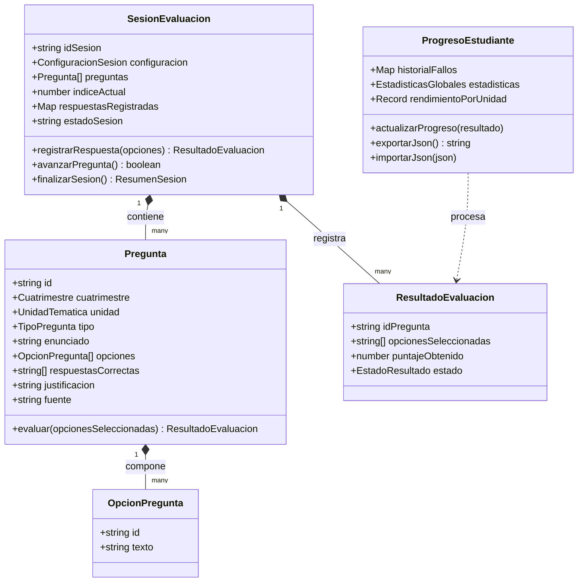

# Modelo de Dominio y Glosario Ubicuo
## Sistema de Evaluación: Ingeniería y Calidad de Software (UTN FRBA)

---

## 1. Glosario de Términos Ubicuos (Ubiquitous Language)

| Término | Definición en el Contexto del Sistema |
| :--- | :--- |
| **Banco de Preguntas** | Repositorio estructurado e inmutable de preguntas de evaluación extraídas de parciales reales y bibliografía de cátedra. |
| **Pregunta** | Unidad atómica de evaluación con enunciado, opciones, respuestas correctas, unidad temática, cuatrimestre y justificación teórica. |
| **Tipo de Pregunta** | Clasificación del formato de respuesta: `VERDADERO_FALSO`, `OPCION_UNICA` o `SELECCION_MULTIPLE`. |
| **Opción** | Cada una de las alternativas seleccionables presentadas al estudiante en una pregunta. |
| **Sesión de Evaluación** | Instancia de ejecución donde el estudiante responde una tanda delimitada o infinita de preguntas bajo una configuración específica. |
| **Tanda** | Conjunto ordenado o aleatorio de preguntas asignadas a una sesión (10, 20, 30 preguntas o modo infinito). |
| **Cuatrimestre** | Subdivisión académica del programa: `PRIMER_CUATRIMESTRE` (1C: Unidades 1 a 4) y `SEGUNDO_CUATRIMESTRE` (2C: Unidades 5 y 6). |
| **Unidad Temática** | Unidad curricular oficial (U1: Introducción, U2: Calidad, U3: Approaches, U4: Estimaciones, U5: SCM, U6: Testing). |
| **Respuesta del Estudiante** | Registro de las opciones seleccionadas por el alumno para una pregunta concreta en un instante determinado. |
| **Evaluación de Respuesta** | Proceso determinista que contrasta la respuesta del estudiante con las opciones correctas y computa el puntaje y estado (`CORRECTA`, `PARCIAL`, `INCORRECTA`). |
| **Puntaje Proporcional** | Valor numérico entre `0.0` y `1.0` que premia aciertos y penaliza errores en preguntas de selección múltiple, con piso en cero. |
| **Justificación Teórica** | Explicación fundamentada en la bibliografía oficial (SWEBoK, ISO 25010, McConell, etc.) que aclara por qué la respuesta correcta es válida y por qué las incorrectas no lo son. |
| **Historial de Fallos** | Registro persistente de preguntas respondidas incorrectamente o con puntaje parcial, para ser practicadas en el Modo Repaso. |
| **Estadísticas de Rendimiento** | Agregación de métricas globales y por unidad temática (tasa de acierto, preguntas respondidas, racha actual y mejor racha). |

---

## 2. Definición de Entidades, Objetos de Valor y Agregados

### 2.1 Agregado: Sesión de Evaluación (`SesionEvaluacion`)
Es la raíz de agregado (`Aggregate Root`) que gestiona el ciclo de vida de una tanda de estudio.

- **Identificador**: `idSesion: string` (UUID v4)
- **Atributos de Estado**:
  - `configuracion: ConfiguracionSesion` (Objeto de Valor)
  - `preguntas: Pregunta[]` (Lista ordenada de preguntas de la sesión)
  - `indiceActual: number` (Índice de la pregunta en curso, 0-indexed)
  - `respuestasRegistradas: Map<string, ResultadoEvaluacion>` (Respuestas emitidas indexadas por idPregunta)
  - `estadoSesion: 'EN_PROGRESO' | 'FINALIZADA'`
  - `fechaInicio: Date`
  - `fechaFin?: Date`
- **Invariantes del Agregado**:
  - No se puede registrar dos veces la respuesta para la misma pregunta dentro de una misma sesión.
  - El `indiceActual` no puede ser menor a 0 ni exceder el total de preguntas (excepto en tanda infinita donde se despachan dinámicamente).
  - La sesión solo se marca como `'FINALIZADA'` cuando se responde la última pregunta de la tanda o cuando el estudiante detiene explícitamente el modo infinito.

---

### 2.2 Entidad: Pregunta (`Pregunta`)
Representa un reactivo del banco de datos.

- **Identificador**: `id: string` (Slug determinista o UUID)
- **Atributos**:
  - `cuatrimestre: Cuatrimestre` (`'1C'` | `'2C'`)
  - `unidad: UnidadTematica` (`'U1'` | `'U2'` | `'U3'` | `'U4'` | `'U5'` | `'U6'`)
  - `tipo: TipoPregunta` (`'VERDADERO_FALSO'` | `'OPCION_UNICA'` | `'SELECCION_MULTIPLE'`)
  - `enunciado: string` (Texto enriquecido con formato y contexto)
  - `opciones: OpcionPregunta[]` (Lista de 2 a 6 opciones posibles)
  - `respuestasCorrectas: string[]` (Lista de identificadores de las opciones correctas)
  - `justificacion: string` (Fundamento bibliográfico oficial)
  - `fuente?: string` (Ej: "Parcial 1 1C2024", "SWEBoK Cap. 7", "Classic Mistakes")
- **Invariantes**:
  - Si `tipo === 'VERDADERO_FALSO'`, la lista de opciones debe contener exactamente dos elementos: "Verdadero" y "Falso", y `respuestasCorrectas` debe contener exactamente un identificador.
  - Si `tipo === 'OPCION_UNICA'`, `respuestasCorrectas` debe tener longitud exacta de 1.
  - Si `tipo === 'SELECCION_MULTIPLE'`, `respuestasCorrectas` debe tener al menos 1 elemento y como máximo la totalidad de las opciones.
  - Todo identificador en `respuestasCorrectas` debe existir dentro de `opciones`.

---

### 2.3 Objetos de Valor (Value Objects)

#### `OpcionPregunta`
- `id: string` (Ej: "a", "b", "c" o "v", "f")
- `texto: string`

#### `ResultadoEvaluacion`
- `idPregunta: string`
- `opcionesSeleccionadas: string[]`
- `puntajeObtenido: number` (Rango `[0.0, 1.0]`)
- `estado: 'CORRECTA' | 'PARCIAL' | 'INCORRECTA'`
- `tiempoRespuestaMs?: number`

#### `ConfiguracionSesion`
- `cuatrimestre: '1C' | '2C' | 'AMBOS'`
- `unidadesFiltro: UnidadTematica[]` (Vacío = todas las del cuatrimestre seleccionado)
- `tipoFiltro: 'TODOS' | 'VF' | 'CHOICE'`
- `tamanoTanda: 10 | 20 | 30 | 'INFINITA'`
- `modo: 'INMEDIATO' | 'REPASO_FALLOS'`

---

### 2.4 Agregado: Perfil y Progreso del Estudiante (`ProgresoEstudiante`)
Gestiona la persistencia a largo plazo y las estadísticas en `LocalStorage`.

- **Atributos**:
  - `historialFallos: Map<string, RegistroFallo>` (Preguntas falladas, contador de errores y última fecha)
  - `estadisticasGlobales`:
    - `totalRespondidas: number`
    - `totalCorrectas: number`
    - `totalParciales: number`
    - `totalIncorrectas: number`
    - `puntajeAcumulado: number`
  - `rendimientoPorUnidad: Record<UnidadTematica, { respondidas: number, correctas: number }>`
  - `sesionesCompletadas: ResumenSesion[]`
- **Operaciones**:
  - `registrarResultado(pregunta: Pregunta, resultado: ResultadoEvaluacion): void`
  - `removerFallo(idPregunta: string): void`
  - `exportarJson(): string`
  - `importarJson(datos: string): void` (Con validación previa Zod)

---

## 3. Diagrama de Relaciones del Dominio

